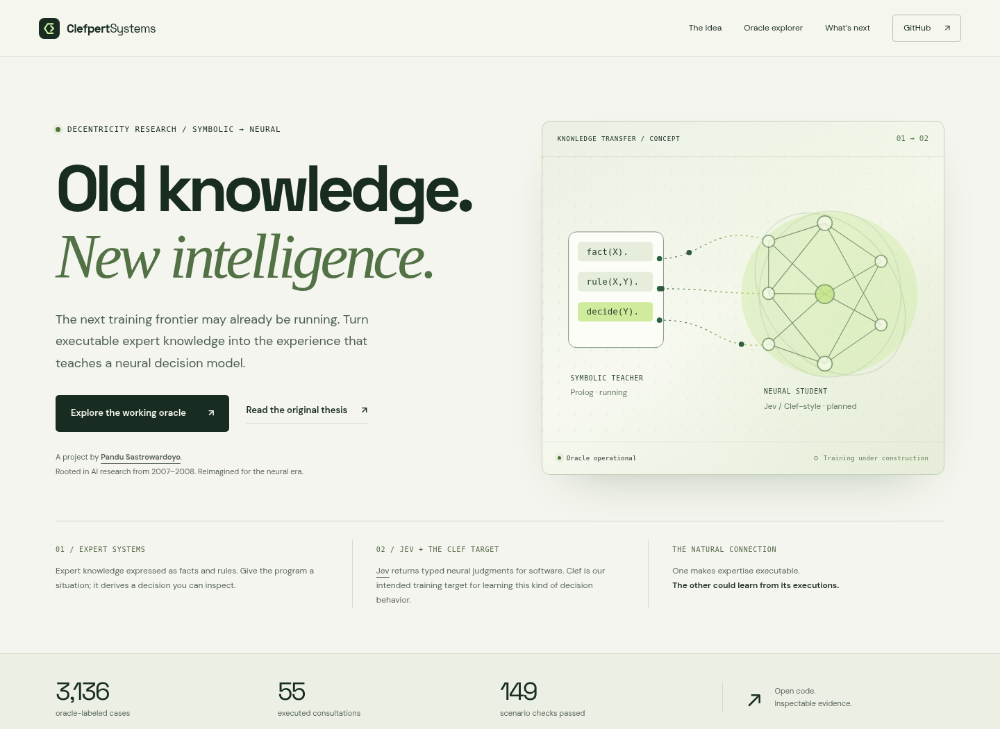
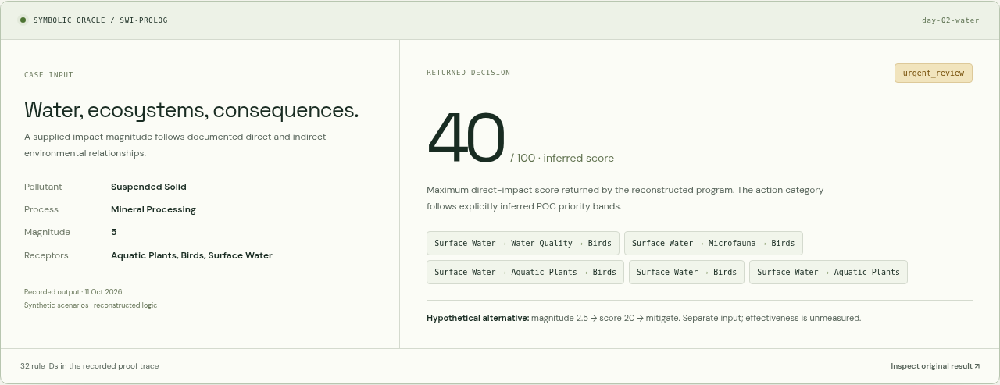

# ClefpertSystems showcase

Public path: **https://decentricity.github.io/clefpertsystems/**

A standalone static research showcase for [Decentricity/ClefpertSystems](https://github.com/Decentricity/ClefpertSystems), published by this repository's existing GitHub Pages setup from `gh-pages` at `/`. No build service, bundler, hosted model calls or credentials are required.

## Experience

- Animated symbolic-to-neural concept diagram, scroll reveals and restrained card motion.
- An interactive recorded-oracle explorer: water pathways, current ambient references and unresolved evidence across five synthetic workdays.
- Full original input/result/rule-trace inspection and pinned links to source records.
- Explicit under-construction cards for model training, comparison and calibration/equivalence results.
- The institutional-knowledge migration thesis and a biography grounded in Pandu Sastrowardoyo's existing portfolio.
- Links to the source repo, original ITB thesis, TypeSafe's model documentation and Pandu's earlier Jev experiment.
- Locally hosted OFL fonts, reduced-motion support, keyboard-accessible controls and responsive layouts.

## Data and claims

`data/oracle-recordings.json` contains 20 **unaltered selected records** from the actual SWI-Prolog execution archive at `Decentricity/ClefpertSystems`, revision `aac9abc03b08d88ca60f0cfc4790c860903bf9a5`. The browser selects saved results; it does not run a live Prolog engine or infer labels in JavaScript. The case explorer offers 15 baseline/ambient/gap views plus five recorded alternative cases within the water views.

The source includes an approximate reconstruction, historical importance weights, explicit POC scoring assumptions, and a separately sourced current US ambient-reference profile. The page preserves those distinctions and presents no trained-model results. Its illustrated neural graph is a conceptual architecture, not evidence of an executed training run.

The broader migration story is a research/platform thesis, not a demonstrated deployment in the suggested future domains. It asks whether executable legacy knowledge can provide training supervision and a retained regression oracle for neural decision models.

Official TypeSafe documentation currently describes Jev as a request-configured typed-judgment model, not a customer-fine-tuned model. Jev is the interface/style reference here. A verified Clef model/training contract remains a planned integration; the page does not claim an available Clef endpoint or supported training schema. `data/source-notes.json` records the checked sources and this distinction.

## Run and verify

Serve the repository root:

```sh
python -m http.server 8765
# Open http://localhost:8765/clefpertsystems/
```

Refresh the selected source records from a local checkout:

```sh
python clefpertsystems/tools/sync_recordings.py --repo /path/to/ClefpertSystems
```

Browser verification requires Python Playwright and Chromium. This environment uses `/usr/bin/chromium`:

```sh
python clefpertsystems/tools/verify_showcase.py --source-repo /path/to/ClefpertSystems
```

The run passed **54 checks**, including source-record identity, every selectable result and prominent returned value, pinned provenance links, six pipeline controls, model placeholders, disclosure controls, widths 320/375/768/1280/1440, mobile keyboard navigation, reduced-motion handling, missing-data-file recovery and no-JavaScript fallback. The checker also captures the desktop/mobile/explorer previews and social card.

Automated axe-core 4.10.3 scans found **zero WCAG A/AA violations** at desktop and mobile widths after contrast fixes. This complements the keyboard/motion checks and is not an accessibility certification.

[Browser report](verification/browser-report.json) · [Accessibility report](verification/accessibility-report.json)





[Complete desktop screenshot](verification/desktop.png) · [Complete mobile screenshot](verification/mobile.png)

Fonts: DM Sans and Space Grotesk. Their OFL licenses are included in `assets/`. The page uses no externally loaded fonts, analytics or API keys.
